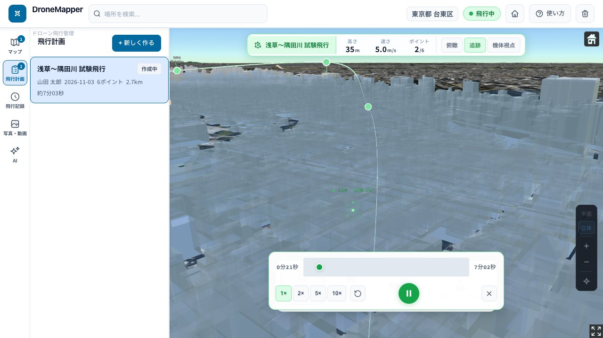

# DroneMapper

**建物の高さを見ながらドローンの飛行ルートを引き、飛ばす前にブラウザ上で確かめるためのアプリ。**
国土交通省 PLATEAU の3D都市モデル（3D Tiles）を地図に使い、現場の下見やデモで「このルートは建物に当たらないか」「何分かかるか」を確認できます。

### [デモを開く → boxpistols.github.io/drone-mapper-plateau](https://boxpistols.github.io/drone-mapper-plateau/)

[](https://github.com/BoxPistols/drone-mapper-plateau/actions/workflows/deploy.yml)



## 見どころ

- **地上高を保つ飛行シミュレーション** — 区間ごとに「距離 ÷ 速度」で実時間を出し、スプライン上を弧長に沿って等速で進む。高さは毎フレーム `globe.getHeight()` の地盤高に地上高を足して求める。→ [`src/sim/flightPath.ts`](src/sim/flightPath.ts)（テスト: [`flightPath.test.ts`](src/sim/flightPath.test.ts)）、[`src/components/CesiumMap.tsx`](src/components/CesiumMap.tsx)
- **AI がアプリを操作して計画を作る（Function Calling）** — 「浅草寺の周りを一周」のような指示から、モデルが `create_flight_plan` や `add_waypoints` などのツールを呼び、ストアを直接更新する。→ [`src/ai/tools.ts`](src/ai/tools.ts)、[`src/ai/useAIChat.ts`](src/ai/useAIChat.ts)。公開版は API キーを含めないため、AI タブはツール一覧と会話例を見せるデモ表示になる
- **実機アプリへ持ち出せる KML 書き出し** — 地盤高 + 地上高を海抜（`altitudeMode=absolute`）で出力し、Google Earth などで同じ高さに再現できる。→ [`src/components/panels/PlansPanel.tsx`](src/components/panels/PlansPanel.tsx)

## クイックスタート

```bash
git clone https://github.com/BoxPistols/drone-mapper-plateau.git
cd drone-mapper-plateau
npm install
cp .env.example .env   # 必要なキーだけ設定（すべて任意）
npm run dev            # http://localhost:5173/drone-mapper-plateau/
```

| 変数 | 用途 | 未設定のとき |
|---|---|---|
| `VITE_CESIUM_TOKEN` | Cesium ion の地形（凹凸のある地表） | 平らな地表で動作する |
| `VITE_OPENAI_API_KEY` | AI アシスタント（GPT-6 Luna） | AI タブはデモ表示 |
| `VITE_GEMINI_API_KEY` | AI アシスタント（Gemini 3.5 Flash-Lite） | 同上 |

`VITE_*` の値はビルド時にクライアントの JS に埋め込まれます。AI のキーは手元の開発用にだけ使い、公開ビルド（`.github/workflows/deploy.yml`）には渡していません。公開版で AI を動かすにはサーバー側のプロキシが必要です。

```bash
npm test         # Vitest
npm run lint     # ESLint
npm run build    # 型チェック + 本番ビルド → dist/
```

---

## 主な機能

| 機能 | 説明 |
|---|---|
| **3D地図ビューアー** | PLATEAU 3D Tiles を表示。平面 / 立体の切り替え |
| **飛行ゾーン描画** | ポリゴンで飛行エリア・禁止区域・注意区域を地図上に登録 |
| **飛行計画作成** | 通過ポイントの配置・高度・速度・アクション設定 |
| **フライトシミュレーション** | 地形追従・俯瞰 / 追跡 / 機体視点の3カメラ・1〜10倍速 |
| **飛行前チェックリスト** | 航空法150m制限警告を含む安全確認6項目 |
| **飛行統計** | 総距離・飛行時間・撮影ポイント数をリアルタイム計算 |
| **KML/JSONエクスポート** | Google Earth などで読み込める KML と、計画そのままの JSON |
| **AIアシスタント** | 自然言語で飛行計画を作成（GPT-6 Luna / Gemini 3.5 Flash-Lite、手元でキーを設定したときのみ） |

---

## 使用している外部サービス・API

### 1. 国土交通省 Project PLATEAU（3D Tiles）

**なぜ使うのか**

ドローン飛行には「実際の建物高さ・形状」の把握が不可欠です。衛星写真の2Dマップでは建物の高さがわからず、飛行経路が建物に干渉するリスクを正確に評価できません。PLATEAUは日本の主要都市を LOD2（外形形状）〜 LOD3（詳細形状・テクスチャ）で3D化したデータを無償公開しており、このアプリの3D表示基盤として使用しています。

**どこで使っているのか**

`src/store/droneStore.ts` の `PLATEAU_CITIES` 配列に、各都市のtileset URLを定義しています：

```typescript
// src/store/droneStore.ts
export const PLATEAU_CITIES: CityConfig[] = [
  {
    id: 'taito',
    name: '台東区',
    tilesUrl: 'https://assets.cms.plateau.reearth.io/assets/.../tileset.json',
    longitude: 139.7965,
    latitude: 35.7150,
    height: 1000,
    lod: 2,
  },
  // ... 7都市
]
```

**どのように使っているのか**

`src/components/CesiumMap.tsx` の都市切替 useEffect 内で `Cesium3DTileset.fromUrl()` を呼び出し、CesiumJS のシーンにタイルセットを追加します：

```typescript
// src/components/CesiumMap.tsx
Cesium3DTileset.fromUrl(city.tilesUrl, {
  maximumScreenSpaceError: 4,  // 精細度（低いほど高品質）
})
.then((tileset) => {
  viewer.scene.primitives.add(tileset)
})
```

テクスチャなし都市（LOD2）は白色スタイルを自動適用し、建物の輪郭が視認しやすくなります。

**対応都市**

| 都市 | 都道府県 | LOD | テクスチャ | 特徴 |
|---|---|---|---|---|
| 台東区 | 東京都 | 2 | なし | 浅草・上野エリア |
| 港区 | 東京都 | 2 | なし | 東京タワー・六本木周辺 |
| 仙台市 | 宮城県 | 2 | なし | 東北最大都市 |
| 加賀市 | 石川県 | 2 | なし | 能登半島近郊 |
| 沼津市 | 静岡県 | **3** | **あり** | 最高精細・テクスチャ付き |
| 広島市 | 広島県 | 2 | なし | 平和公園周辺 |
| 福岡市 | 福岡県 | 2 | あり | 中洲・天神エリア |

**データライセンス**

国土交通省 Project PLATEAUのデータは [CC BY 4.0](https://creativecommons.org/licenses/by/4.0/) または独自ライセンスで公開されています。各データセットの利用規約を確認してください。
- 公式サイト: https://www.mlit.go.jp/plateau/
- データダウンロード: https://www.geospatial.jp/ckan/dataset/plateau

---

### 2. CesiumJS + Cesium ion（地形データ）

**なぜ使うのか**

CesiumJS は WebGL ベースの3D地球儀ライブラリで、3D Tiles の標準実装を持つ唯一の主要OSS です。ドローンの飛行高度は「地表からの高さ（AGL）」で管理しますが、実際の表示には「海抜高度（MSL）」への変換が必要です。CesiumJS の `globe.getHeight()` API でピクセル単位の地盤高を取得し、正確な飛行高度を計算しています。

Cesium ion は地形タイル（CesiumWorldTerrain）の配信サービスです。トークンなしでも動作しますが、地形の凹凸精度が低下します。

**どこで・どのように使っているのか**

```typescript
// src/components/CesiumMap.tsx

// 1. 地形プロバイダーの設定（マウント時）
createWorldTerrainAsync().then((t) => {
  viewer.terrainProvider = t
})

// 2. 地盤高の毎フレーム取得（preRender ループ）
const carto = Cartographic.fromDegrees(droneSimBridge.lon, droneSimBridge.lat)
droneSimBridge.groundAlt = viewer.scene.globe.getHeight(carto) ?? 0

// 3. 飛行高度の計算
// 表示高度 = groundAlt（地盤高 MSL）+ altAGL（地上高）
const pos = Cartesian3.fromDegrees(lon, lat, groundAlt + altAGL)
```

**地表クリックのピッキング方式**

`pickPosition()` はポリゴンエンティティ表示中に誤った深度を返すバグがあるため、代わりに `globe.pick(ray)` のみを使用しています。これはカメラからのレイと地形メッシュの純粋な数学的交点を求める手法で、レンダリング状態に依存しない最も安定した方法です。

```typescript
// pickPosition() は使わない（PolylineGraphicsで深度ズレが発生するため）
const ray = viewer.camera.getPickRay(pos)
const cartesian = viewer.scene.globe.pick(ray, viewer.scene)
```

---

### 3. OpenAI API（AIアシスタント）

**なぜ使うのか**

飛行計画の作成は「地図を見ながらウェイポイントを1つずつ配置する」という作業が基本ですが、初心者には難しく時間もかかります。AIが「浅草から隅田川沿いに飛ばして」という自然言語指示を受け取り、適切なウェイポイント座標・高度・速度を自動生成することで、計画作成を大幅に効率化します。

**どこで使っているのか**

```
src/ai/
├── useAIChat.ts    # ストリーミング対応の会話Hookとツール実行ループ
└── tools.ts        # AIが操作できるアプリ機能の定義
```

**どのように使っているのか**

OpenAI API の **Function Calling（関数呼び出し）** 機能を使い、AIが直接アプリの状態を操作します：

```typescript
// src/ai/tools.ts に定義されたツール一覧
const tools = [
  {
    name: 'get_app_state',
    description: '現在の飛行計画・ピン・ゾーンの状態を取得',
  },
  {
    name: 'create_flight_plan',
    description: '新しい飛行計画を作成',
    parameters: { name: string, description?: string }
  },
  {
    name: 'add_waypoints',
    description: 'ウェイポイントを複数追加',
    parameters: { planId: string, waypoints: WaypointInput[] }
  },
  {
    name: 'select_city',
    description: '表示都市を切り替え',
  },
  {
    name: 'add_pin',
    description: '地図にランドマークピンを追加',
  },
  {
    name: 'start_simulation',
    description: '指定した計画のシミュレーションを開始',
  },
]
```

会話はストリーミングで受け取り、応答を届いた分から表示します：

```typescript
// src/ai/useAIChat.ts
// 1. ユーザーメッセージを送信
// 2. finish_reason === 'tool_calls' になるまでストリーミング受信
// 3. function calling があればアプリ操作を実行
// 4. ツール結果をAPIに返送 → AIが最終回答を生成
```

使用モデル: **GPT-6 Luna**（`gpt-6-luna`、既定）／ **Gemini 3.5 Flash-Lite**（`gemini-3.5-flash-lite`、Gemini の OpenAI 互換エンドポイント経由）。定義は `src/ai/useAIChat.ts` の `AI_MODELS`。

**セキュリティ上の注意**

現在の実装は手元の開発用にブラウザから直接 API を呼び出しています（`dangerouslyAllowBrowser: true`）。キーがクライアントに埋め込まれるため、公開ビルドにはキーを渡していません（AI タブはデモ表示）。公開版で動かすには、キーをサーバー側に置いてプロキシ経由で呼ぶ必要があります。

---

### 4. Cesium ion Asset（補助データ）

標準的な地図タイル（Bing Maps衛星写真・OpenStreetMap）は Cesium ion のデフォルトアセットとして自動ロードされます。PLATEAU 3D Tilesと組み合わせることで、衛星写真の上に3D建物モデルが重畳表示されます。

---

## アーキテクチャ

```
src/
├── ai/
│   ├── tools.ts          # OpenAI AIツール定義・実行マッピング
│   └── useAIChat.ts      # ストリーミング会話Hook（tool-use ループ）
│
├── components/
│   ├── CesiumMap.tsx     # 3Dビューアーのすべて
│   │                     #   - PLATEAU 3D Tiles ロード・切り替え
│   │                     #   - エンティティ（ピン/ゾーン/WP/ドローン）管理
│   │                     #   - クリック・右クリックイベント処理
│   │                     #   - preRender ループ（カメラ追従・地盤高更新）
│   │                     #   - 平面 / 立体 モード切り替え
│   ├── PreflightChecklist.tsx  # 飛行前安全確認モーダル
│   ├── map/
│   │   ├── SimPlayer.tsx  # シミュレーションHUD・RAFループ
│   │   ├── MapToolbar.tsx # 地図操作モード選択バー
│   │   └── MapEntityPopup.tsx  # ピン/ゾーン/WP のインライン編集
│   └── panels/
│       ├── MapPanel.tsx   # 都市選択・ピン・ゾーン管理
│       ├── PlansPanel.tsx # 飛行計画CRUD・統計・エクスポート
│       ├── AIPanel.tsx         # AIチャット UI（キーがあるビルド）
│       └── AIDemoPanel.tsx     # AI のデモ表示（公開版）
│
├── sim/
│   └── droneSimBridge.ts  # React-Cesium Bridge（ミュータブル共有オブジェクト）
│
├── store/
│   └── droneStore.ts      # Zustand ストア + localStorage 永続化
│
└── types.ts               # 全型定義
```

---

## シミュレーションの仕組み

### Bridge Pattern（60fps を実現するための設計）

React の `setState` は非同期・バッチ処理であるため、毎フレーム呼び出すと描画が点滅します。そこで **ミュータブルなブリッジオブジェクト** `droneSimBridge` を介して SimPlayer と CesiumMap を直結しています。

```
SimPlayer（requestAnimationFrame ループ）
  │
  │ 毎フレーム書き込む: lon / lat / altAGL / heading / cameraMode
  ↓
droneSimBridge（src/sim/droneSimBridge.ts）
  │                              ← React の setState を迂回
  │ 毎フレーム読み出す
  ↓
CesiumMap.preRender リスナー
  │ globe.getHeight() → groundAlt を更新
  │ CallbackProperty が自動的に表示位置を更新
  ↓
CesiumJS エンティティ（60fps で点滅なし）
```

### フェーズベース時間管理

各セグメントの所要時間は「距離 ÷ 速度」で計算し、ホバー時間を加算した **累積タイムライン** を構築します。等分割（全セグメント同一時間）ではないため、速度差のあるルートでも正確に再現します。

```typescript
// 例: WP1→WP2 距離200m @ 5m/s = 40秒
//     WP2 ホバー = 10秒
//     WP2→WP3 距離500m @ 10m/s = 50秒
// タイムライン: [0〜40s: 飛行] [40〜50s: ホバー] [50〜100s: 飛行]
```

### 高度系の管理

```
altAGL    地上高（ユーザーが設定）    例: 50m
groundAlt 地盤高・海抜（MSL）        例: 8m  ← globe.getHeight() で毎フレーム取得
表示高度  = groundAlt + altAGL     例: 58m（絶対海抜高度）
```

この方式により、地形の起伏に追従しながら「常に地面から50m」の飛行を正確に表現できます。

---

## 飛行規制への対応

### 航空法 150m 制限

ウェイポイントの高度（AGL）が 150m を超えた場合:

1. ウェイポイント行に「150m超」バッジを表示
2. 飛行統計の最大高度を赤字で表示
3. 飛行前チェックリストに「国土交通省への申請が必要」と警告を表示

```typescript
// src/components/panels/PlansPanel.tsx
const overLimit = wp.altAGL > 150
// → バッジ・警告・チェックリストへ反映
```

### 飛行前チェックリスト

シミュレーション開始時に必須確認する6項目:

1. バッテリー残量（80%以上）
2. 気象条件（風速・視界）
3. NOTAM・飛行禁止情報
4. 飛行エリアの安全確認
5. 機体整備・点検
6. 許可・申請（DID地区等）

全項目をチェックしないとシミュレーション（≒実飛行の事前確認）を開始できない設計です。

---

## データ・ファイル管理

### ローカル永続化（localStorage）

飛行計画・ピン・ゾーンは Zustand の `persist` ミドルウェアでブラウザの localStorage に自動保存されます。シミュレーション実行状態は揮発性（保存されません）。

### エクスポート形式

**JSON 形式**
`FlightPlan` オブジェクトをそのままJSONに書き出します。同アプリへのインポートや、バックエンド連携に使用できます。

**KML 形式**
Google Earth / DJI Pilot 2 / QGroundControl などのドローン運航管理ソフトで読み込める形式です。ウェイポイントの `absolute` 高度（MSL = groundAlt + altAGL）で書き出します。

```xml
<!-- 出力例 -->
<LineString>
  <altitudeMode>absolute</altitudeMode>
  <coordinates>
    139.7940,35.7110,36.0
    139.7980,35.7130,65.0
    ...
  </coordinates>
</LineString>
```

---

## 操作リファレンス

### マップ操作

| 操作 | 動作 |
|---|---|
| 左クリック（選択モード）| 地図を移動・3D建物の属性を表示 |
| **右クリック**（エンティティ）| **ピン・ゾーン・WPの編集ポップアップを表示** |
| 右クリック（空白）| ポップアップを閉じる |
| ドラッグ | 視点移動 |
| スクロール | ズーム |
| 右ドラッグ / 2本指 | 視点回転・傾き変更 |

### キーボードショートカット

| キー | 動作 |
|---|---|
| **Space** | シミュレーション 再生 / 一時停止 |
| Escape | 描画モードをキャンセル / ポップアップを閉じる |

### マップコントロールパネル（右下）

| ボタン | 動作 |
|---|---|
| 平面 | 真上から見る平面地図に切り替え（現在地保持） |
| 立体 | 3D 表示に切り替え（デフォルト） |
| ＋ / − | ズームイン / アウト |
| ⊕ | カメラの傾き（roll）をリセット |

---

## 技術スタック

| 技術 | バージョン | 用途 |
|---|---|---|
| React | 19 | UIフレームワーク |
| TypeScript | 5.9 | 型安全な開発 |
| Vite | 8 | ビルドツール |
| CesiumJS | 1.139 | 3D地球儀・3D Tiles表示 |
| Zustand | 5 | グローバル状態管理 |
| `openai` | ^6 | OpenAI / Gemini（OpenAI 互換）API クライアント |
| `vite-plugin-cesium` | 1.2 | CesiumJSのVite統合 |

---

## 開発者向け情報

### ビルドコマンド

```bash
npm run dev      # 開発サーバー起動 (http://localhost:5173/drone-mapper-plateau/)
npm test         # Vitest
npm run build    # 型チェック + 本番ビルド → dist/
npm run lint     # ESLint 実行
npx tsc -b       # 型チェックのみ
```

### コーディング規約

- **AGL/MSL の混在厳禁**: `altAGL`（地上高）と `groundAlt`（海抜地盤高）は必ず区別する
- **droneSimBridge への書き込みは SimPlayer のみ**: preRender からの読み取り専用
- **`globe.pick()` のみ使用**: `pickPosition()` は廃止（PolylineGraphics 時に深度ズレ発生）
- `depthTestAgainstTerrain` は意図的に無効化（有効化するとピッキング精度低下）
- CSS の `--accent` 色変数を使用（ハードコードの blue 禁止）

### Agent Teams（AI 協調開発）

このプロジェクトは Claude Code の複数エージェントで開発されています。詳細は [CLAUDE.md](./CLAUDE.md) を参照してください。

---

## ライセンス

- **アプリケーションコード**: MIT License
- **PLATEAU 3D都市モデル**: 各データセットのライセンスに従う（CC BY 4.0 等）
  - 公式: https://www.mlit.go.jp/plateau/
- **CesiumJS**: Apache 2.0 License
